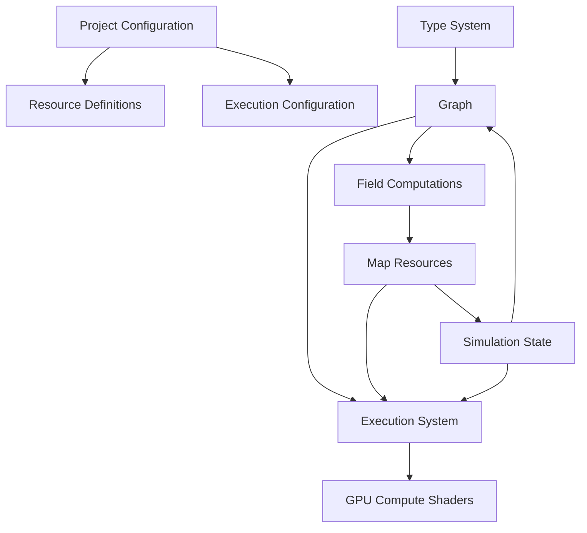

# Architecture

## Overview

The project is a procedural world-generation editor based on a visual node graph.

Users construct computational graphs that describe how a world is generated and how its properties evolve through simulation.

Graphs are compiled to WGSL and executed through GPU compute shaders.

The system is designed around a separation of configuration, computation, storage, simulation, and execution.

## Core Concepts

### Configuration

Configuration defines the environment in which computations execute.

It describes:

- World representation.
- World dimensions and bounds.
- Chunk dimensions and layout.
- Map resources.
- Simulation settings.
- Execution settings.

Configuration is managed separately from the node graph.

### Graphs

Graphs describe computations.

They consist of nodes connected through typed input and output ports.

Graphs describe what should be calculated, not how resources are allocated or how computations are dispatched.

Ordinary graphs are acyclic.

### Types

Types describe the data passed between nodes.

The type system contains scalar, vector, and matrix types.

Domain concepts such as positions, elevation, and moisture use these existing types rather than introducing dedicated types.

See [Types](TYPES.md).

### Fields

Fields describe spatially distributed values.

A field defines how a value is calculated at a given position.

Fields can be composed, evaluated directly, or materialized into maps.

See [Fields](FIELDS.md).

### Maps

Maps are allocated resources that store spatial data.

They allow computations to share data and provide persistent storage for simulation state.

Map configuration and allocation are managed outside the graph.

See [Maps](MAPS.md).

### Simulation

Simulation provides persistent state and controlled feedback between iterations.

Processes read the current state and produce updates that become available at defined commit boundaries.

See [Simulation](SIMULATION.md).

### Subgraphs

Subgraphs encapsulate reusable computations.

They allow users to build higher-level world-generation functionality from smaller computational primitives.

See [Subgraphs](SUBGRAPHS.md).

### Execution

The execution system compiles graphs to WGSL, resolves resource references, manages GPU resources, determines execution order, and dispatches compute shaders.

See [Execution](EXECUTION.md).

## System Relationships

## Architectural Separation

Each subsystem has a defined responsibility.

| Subsystem | Responsibility |
|---|---|
| Configuration | Defines the world and its resources |
| Types | Defines data representation |
| Graph | Describes computations |
| Nodes | Implements computational operations |
| Fields | Describes spatial computations |
| Maps | Stores spatial data |
| Simulation | Manages persistent state and feedback |
| Subgraphs | Encapsulates reusable computations |
| Execution | Compiles, schedules, and executes computations |

## Architectural Principles

1. **Configuration is separate from computation.** World, chunk, map, and simulation settings do not belong inside nodes.
2. **Nodes describe operations.** They do not manage resource allocation or execution lifecycle.
3. **Types describe data representation.** Domain concepts do not require dedicated types unless their representation genuinely differs.
4. **Fields describe spatial computations.** They do not inherently require allocated storage.
5. **Maps store spatial data.** They are configured and allocated outside the graph.
6. **Resources are referenced by identity.** Graphs do not own the resources they consume.
7. **Simulation state is persistent.** It evolves through controlled updates.
8. **Feedback occurs across iterations.** Ordinary graphs remain acyclic.
9. **State updates have explicit commit boundaries.** Processes do not observe partially updated state.
10. **Subgraphs provide higher-level functionality.** Specialized algorithms are built from reusable primitives.
11. **Execution is GPU-oriented.** Computation and intermediate data should remain GPU-side wherever possible.

## Scope

The project focuses on procedural world-generation data and simulation.

Rendering, meshes, materials, colors, and other presentation-specific concerns are outside the scope of the graph system.